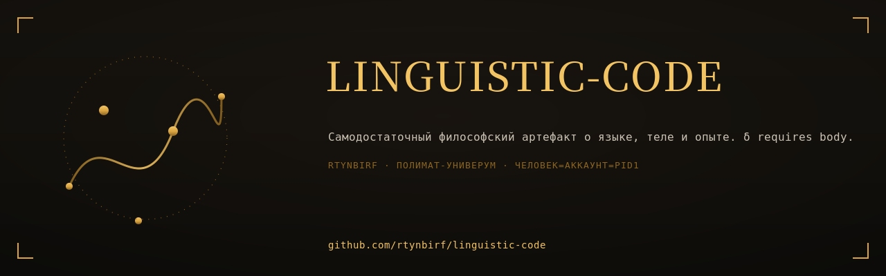

# Linguistic Code

<div align="center">
  
</div>


> Самодостаточный интерактивный философский артефакт о языке, теле и опыте.
> Один HTML-файл. Без серверов. Без трекинга. δ requires body.

## Что это

**Linguistic Code** — проект на пересечении философии языка, когнитивной науки и веб-дизайна. Это не статья и не приложение. Это **соматическое устройство**, создающее условие, при котором читатель наблюдает собственную языковую привычку как одну из возможных конфигураций.

## Структура репозитория

```
linguistic-code/
├── README.md                 ← этот файл
├── .gitignore
├── dist/                     ← финальные HTML-артефакты
│   ├── linguistic-code-epochs.html       (6 эпох языка, без анахронизмов)
│   ├── linguistic-code-v19-tetraptych.html  (33 тезиса + 8 слоёв адаптивности)
│   └── linguistic-code-v18.1-final.html  (архив: Structural Honesty, 37 ссылок)
├── src/                      ← генераторы (Python)
│   ├── build_epochs.py
│   ├── build_v19_tetraptych.py
│   ├── build_v18_3.py
│   └── lc17_critique.py
├── docs/                     ← документация
│   ├── STATE_OF_HOUSE.md     (хозяйский аудит проекта)
│   └── LC17_critique.pdf     (полиматический разбор v17)
└── archive/                  ← оригинал
    └── linguistic-code-v17-final.html
```

## Артефакты

### linguistic-code-epochs.html
6 языковых эпох — каждая своим словарем, без анахронизмов.

| Эпоха | Даты | Словарь |
|---|---|---|
| I. Устная древность | VIII–V вв. до н.э. | μῦθος, ἔπος, μνήμη, κλέος |
| II. Полис и логос | V–II вв. до н.э. | λόγος, ἰδιώτης, ὑπόμνημα |
| III. Скрипторий | V–XV вв. | scriptorium, codex, glossa, auctoritas |
| IV. Гуманизм и печать | XV–XVII вв. | typographia, incunabulum, editio |
| V. Филология и структурализм | XVIII–XX вв. | signe, signifiant, signifié |
| VI. Когнитивная эра и LLM | XXI в. | token, attention, embedding |

### linguistic-code-v19-tetraptych.html
33 тезиса + 8 слоёв адаптивности:
1. CAVE (ловушка 560px)
2. SCRIPTORIUM (манифест 740px)
3. ARIADNE THREAD (Ghost Rail справа)
4. BREATH (clamp() + Progress Thread)
5. FOVEA (активный тезис резкий)
6. MARGIN MEMORY
7. EPHEMERAL NAVIGATOR (клавиша M)
8. Эпистемическая подпись

## Технологии

- HTML5, CSS3 (clamp, min, prefers-reduced-motion)
- JavaScript (IntersectionObserver, IntersectionObserverEntry)
- Python 3 (генераторы артефактов)
- Playwright (валидация)
- Google Fonts: Cormorant Garamond, Inter, JetBrains Mono

## Принципы

1. **Самодостаточность** — один файл, без серверов (тезис 33)
2. **Эпистемическая честность** — каждый тезис маркирует «что НЕ знаем»
3. **Без анахронизмов** — каждая эпоха говорит своим языком
4. **Соматический интерфейс** — каждый визуальный элемент управляет вниманием тела (тезис 31)
5. **prefers-reduced-motion** — WCAG 2.1 SC 2.3.3

## Лицензия

Проект создан коллективным разумом человека и AI (Z.ai, DeepSeek, Qwen).
Свободен для использования, модификации и распространения.

## Связанные версии

- v17 (оригинал) → `archive/`
- v18.1 (Structural Honesty) → `dist/`
- v19 (Тетраптих) → `dist/`
- Epochs (Хронотоп языка) → `dist/`
- v20 «Хронотоп» (запланирован: ловушка + эпохи + адаптивность)
